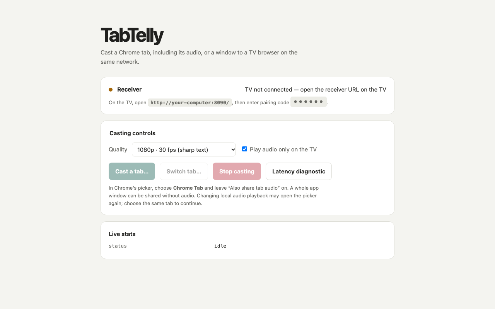

<p align="center"></p>

# TabTelly

[](https://github.com/jckceo/tabtelly/actions/workflows/ci.yml)

Cast a Chrome tab with audio to a compatible TV browser over local Wi-Fi.

TabTelly uses Chrome's screen picker and a direct WebRTC connection. The TV opens a web page; there is no receiver app to install, account to create, or cloud relay. It is useful when a television has a capable browser but no casting protocol your computer can use.



> [!IMPORTANT]
> TabTelly is an experimental local-network tool. It is not an AirPlay or Chromecast implementation, and it does not bypass DRM or protected-stream restrictions.

## Quick start

You need Python 3.10 or later, desktop Google Chrome, and a TV browser with WebRTC support. The computer and TV must be able to reach each other on the same LAN. The runtime has no pip dependencies.

Download the [source ZIP](https://github.com/jckceo/tabtelly/archive/refs/heads/main.zip), or choose **Code → Download ZIP** on [GitHub](https://github.com/jckceo/tabtelly). Extract it and open a terminal in the folder containing `server.py` and `tabtelly` before running the commands below. Versioned source archives will also be available from Releases when a release is published. On macOS or Linux, make the launchers executable if the ZIP did not preserve permissions:

```bash
chmod +x tabtelly tabcast
```

On macOS or Linux:

```bash
./tabtelly start
```

On Windows:

```powershell
python tabtelly start
```

Startup prints the sender page (`http://localhost:8090/send`), the receiver URL for the TV, and a six-digit pairing code. Open the receiver URL on the TV, enter the code, then choose **Cast a tab** in Chrome.

Keep the small Picture-in-Picture controller open while casting; closing it stops the session. If Chrome cannot open the controller, keep the sender page visible.

See [Getting started](docs/GETTING_STARTED.md) for setup and permissions.

## How it works

```text
Chrome tab ── getDisplayMedia() ──> sender page
                                         │
                                  WebRTC media
                                         │
                                         v
                                  TV web browser

          Python server: static files + local HTTP signaling
```

Media travels directly between Chrome and the TV browser using WebRTC encryption. A Python standard-library server hosts the pages and relays signaling messages on the LAN. TabTelly does not use STUN, TURN, or a hosted service.

The sender page is available only through loopback. Its runtime token is injected into the HTML response and never placed in the `/send` URL. A six-digit code pairs the TV with the current sender; messages are accepted only for the authenticated role and current peer ID. Signaling still uses plain HTTP on the LAN, so treat the network as part of the trust boundary and never port-forward TabTelly.

Read [Architecture](docs/ARCHITECTURE.md) and [Security](SECURITY.md) for the full model.

## Commands

```text
./tabtelly start [--no-open]  Start the server; optionally do not open Chrome
./tabtelly stop               Stop the cast and server
./tabtelly restart            Restart the server; clients must reload and re-pair
./tabtelly status             Show server, sender, and receiver status
./tabtelly log                Follow the server log
./tabtelly doctor             Check the local environment and network setup
./tabtelly --version          Print the installed version
```

Use `python tabtelly ...` on Windows. The legacy `./tabcast` command remains as a compatibility wrapper.

| Variable | Default | Purpose |
| --- | --- | --- |
| `TABTELLY_PORT` | `8090` | Local HTTP port |
| `TABTELLY_BIND` | `0.0.0.0` | `0.0.0.0` for LAN use; `127.0.0.1` for local tests |
| `TABTELLY_LAN_IP` | auto-detected | Explicit IPv4 address advertised to the TV |
| `TABTELLY_RUNTIME_DIR` | `.run/<port>` | Log and ephemeral session storage |

The earlier `TABCAST_*` names remain aliases. If both forms are set, use the `TABTELLY_*` name. Runtime files contain session secrets and are excluded from version control.

Only `0.0.0.0` and `127.0.0.1` are accepted bind values. A loopback-only bind cannot serve the TV receiver.

## Compatibility

TabTelly currently targets desktop Chrome on macOS. Linux and Windows are experimental. [Automated command checks cover Linux, Windows, and macOS](https://github.com/jckceo/tabtelly/actions/workflows/ci.yml); this does not constitute native screen-capture or real-TV validation. Receiver compatibility depends on the TV browser's WebRTC implementation. The original prototype worked with a legacy Chromium-based Hisense VIDAA browser, but current real-hardware retesting is not available.

Only one sender and one receiver are supported. Hotel and guest Wi-Fi commonly isolates clients; TabTelly cannot work when the computer and TV cannot connect directly. Do not assume public Wi-Fi is safe merely because pairing is enabled.

See [Compatibility](docs/COMPATIBILITY.md) for known limits.

## Capture and quality notes

- Quality presets are targets. Actual resolution, frame rate, bitrate, and latency depend on Chrome, the source, receiver, and network.
- Tab audio depends on Chrome and the operating system. Window audio is not promised.
- Chrome's normal GCC behavior is the default. Add `?cc=loss` to try the experimental loss-oriented mode.
- Optional `?keepalive=1` may help prevent background throttling. Keeping the Picture-in-Picture controller open is preferred.
- DRM-protected video may be blank, blocked, or silent by design.

## Documentation

- [Getting started](docs/GETTING_STARTED.md)
- [Compatibility](docs/COMPATIBILITY.md)
- [Troubleshooting](docs/TROUBLESHOOTING.md)
- [Architecture](docs/ARCHITECTURE.md)
- [FAQ](docs/FAQ.md)
- [Project story](docs/STORY.md)
- [Contributing](CONTRIBUTING.md)
- [Security policy](SECURITY.md)
- [Changelog](CHANGELOG.md)

## Development

```bash
python3 -m unittest discover -s tests -v
npm ci
npx playwright install chromium
npm run check
npm run test:web
npm run test:e2e
python3 scripts/build_release.py
```

See [CONTRIBUTING.md](CONTRIBUTING.md) for validation expectations.

## License

[MIT](LICENSE) © 2026 jckceo.
